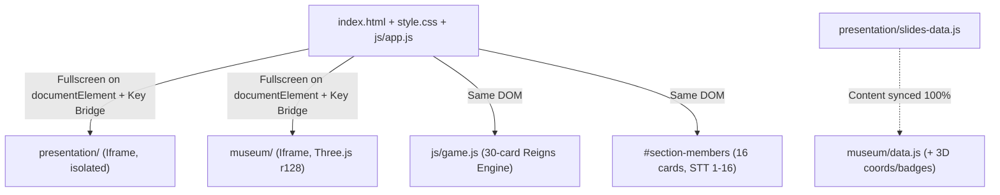

# Bugfix, Memory Leak & UI Polish Implementation Plan

> **For agentic workers:** REQUIRED SUB-SKILL: Use superpowers:executing-plans to implement this plan task-by-task. Steps use checkbox (`- [ ]`) syntax for tracking.

**Goal:** Fix all 5 audited issue groups (Reigns game feedback/scoring, Three.js WebGL memory leaks, 1366x768 QR/slide overflow, iframe Shift-Lock & stale references, data/docs sync) plus the 3 UI/UX improvements (compact 3D quick-nav badges, Members tab hierarchy & styling, and persistent-position desktop-only Fullscreen toggle).

**Architecture:** The app uses a parent shell ([index.html](file:///d:/KTCT_WEB_GRP8/index.html), [style.css](file:///d:/KTCT_WEB_GRP8/style.css), [js/app.js](file:///d:/KTCT_WEB_GRP8/js/app.js), [js/game.js](file:///d:/KTCT_WEB_GRP8/js/game.js)) that hosts two isolated iframes: standalone slides ([presentation/](file:///d:/KTCT_WEB_GRP8/presentation/index.html)) and Three.js 3D museum ([museum/](file:///d:/KTCT_WEB_GRP8/museum/index.html)). Fixes preserve strict isolation between `presentation/` and `museum/`, replace heuristic game scoring with explicit KTCT-aligned choice quality + danger-zone override, recursively dispose Three.js scene resources, and use document-level Fullscreen with viewport/capability gating.

**Architecture Diagram:**



**Tech Stack:** Vanilla JavaScript (ES6 IIFE modules), HTML5, Tailwind CSS CDN, Three.js r128, QRCode.js, Node.js v24 + headless Chromium/Edge for automated verification.

## Global Constraints

- Keep `presentation/` and `museum/` strictly isolated (`presentation/` must not depend on `museum/` or Three.js).
- Do NOT remove or rename any existing core DOM element `id`s in `index.html`, `presentation/index.html`, or `museum/index.html`.
- Keep all 16 `MSSV: [MSSV]` placeholders in `index.html` intact.
- Keep `QR_TARGET_URL` pointing to `https://allendq1-lmq.github.io/KTCT_MacLenin_WebThuyetTrinh_Grp8/`.
- Follow existing code style (Vanilla JS IIFE modules, Tailwind utility classes, Vietnamese UI text & comments).

## Review Focus

- **Danger-zone override on `"correct"` choices:** When a card option has `quality: "correct"`, pushing a stat deeper into `< 20` or `> 80` must override to `"wrong"`, while recovering from `< 20` upward or `> 80` downward must remain `"correct"`.
- **Recursive Three.js disposal with shared materials/nested groups:** Disposing `wallMat` (shared by 4 walls), `trimMat`, `legMat`, `torsoMaterials` (array of 6 materials), and nested `THREE.Group` hierarchies (`pillarGroup -> frame -> canvasMesh`) must not throw and must leave `renderer.info.memory` stable across room switches.
- **Flexbox scroll overflow on short 1366x768 & mobile landscape viewports:** Both `#qr-modal` and `#pres-slide-body` must allow scrolling to the very top item as well as the bottom item when overflowing (no clipped top under `justify-center`).
- **Iframe Shift-Lock rejected Promise:** Pressing `Shift` before focusing the iframe or without user activation must reject silently without throwing an unhandled Promise rejection in Chromium.
- **Fullscreen state & mobile suppression:** On desktop (`>= 768px`) in `content` or `idea2` tabs, entering/exiting fullscreen keeps `#btn-fullscreen-museum` visible in the top-right header and updates its text/icon; on `< 768px` or unsupported browsers (e.g., iOS Safari), the button stays hidden regardless of tab switches.

---

### Task 1: Fix Game Thể Chế Banner Leak & Choice Scoring (`index.html`, `js/game.js`)

**Files:**
- Modify: `index.html:568-580`
- Modify: `js/game.js:13-536`, `js/game.js:753-782`, `js/game.js:837-953`
- Test: temporary Node verification script (cleaned up or run inline via `node -e`)

**Interfaces:**
- Produces: `window.ReignsGame.evaluateChoiceQuality(oldStats, newStats, decision)` (exposed or tested via module) and `quality: "correct" | "wrong"` on every card's `left` and `right` object in `reignsDeck`.

- [ ] **Step 1: Write failing verification check (RED)**
  Run a Node check verifying: (a) `#card-feedback-banner` is inside `#game-play-area` in `index.html`, (b) cards #05, #14, #18, #19 have a `"correct"` balanced option and `"wrong"` extreme option via `evaluateChoiceQuality` from `{50,50,50,50}`, and (c) triggering Game Over or Victory hides `#card-feedback-banner`.
  Expected: FAIL (banner is outside `#game-play-area`; cards #05, #14, #18, #19 return `"wrong"` for both sides).

- [ ] **Step 2: Move `#card-feedback-banner` inside `#game-play-area` in `index.html`**
  Move `#card-feedback-banner` (`index.html:568-572`) immediately inside `<div id="game-play-area" ...>` right above the card stack wrapper.

- [ ] **Step 3: Add `hideFeedbackBanner()` helper, explicit `quality` on all 30 cards, and update `evaluateChoiceQuality()` in `js/game.js`**
  - Add `quality: "correct" | "wrong"` to every `left` and `right` object in `reignsDeck` (`#01`–`#30`) aligned with KTCT Mác - Lênin principles.
  - Update `evaluateChoiceQuality(oldStats, newStats, decision)` (and its call in `applyChoice()`) so it checks `pushedIntoDanger` (`(newStats[k] < 20 && delta < 0) || (newStats[k] > 80 && delta > 0)`): return `"wrong"` if true, else `decision.quality === "wrong" ? "wrong" : "correct"`.
  - Extract `hideFeedbackBanner()` and call it in both `checkGameOver()` (on `failureKey` or `currentYear >= maxYears`) and `resetGame()`.

- [ ] **Step 4: Run verification check (GREEN)**
  Run Node verification script checking DOM placement, `hideFeedbackBanner()` on win/lose, and all 30 cards (`#05`, #14, #18, #19 balanced choices = `"correct"`, extreme = `"wrong"`, danger-zone override = `"wrong"`).
  Expected: PASS.

- [ ] **Step 5: Commit**
  `git add index.html js/game.js && git commit -m "fix(game): fix stuck feedback banner and explicit choice quality scoring"`

---

### Task 2: Fix WebGL Memory Leak in Three.js Scene Cleanup (`museum/engine.js`)

**Files:**
- Modify: `museum/engine.js:519-532`

**Interfaces:**
- Produces: recursive `clearScene()` using `obj.traverse(...)` and `disposeMaterial(mat)` inside `museum/engine.js`.

- [ ] **Step 1: Write failing verification check (RED)**
  Run a Node/mocked-THREE test building rooms 1, 2, 3 and avatar, calling `clearScene()`, and asserting all `geometry.dispose()`, `material.dispose()`, array material items, and texture `.dispose()` (`map`, `emissiveMap`, etc.) are called.
  Expected: FAIL (0 nested mesh geometries/materials/textures disposed because `scene.children` only holds `THREE.Group` and lights).

- [ ] **Step 2: Implement `disposeMaterial(mat)` and recursive `obj.traverse` inside `clearScene()` (`museum/engine.js`)**
  Traverse every removed scene child, disposing `child.geometry`, single or array `child.material`, all texture slots (`map`, `lightMap`, `bumpMap`, `normalMap`, `emissiveMap`, `roughnessMap`, `metalnessMap`, `alphaMap`, `aoMap`, `specularMap`, `envMap`), `child.shadow?.map`, and `child.dispose?.()`.

- [ ] **Step 3: Run verification check (GREEN)**
  Re-run mock-THREE traversal test + real headless Chrome/Edge check switching Room 1 -> 2 -> 3 -> 1 and inspecting `renderer.info.memory` (or geometry/texture disposal counts).
  Expected: PASS.

- [ ] **Step 4: Commit**
  `git add museum/engine.js && git commit -m "fix(museum): recursively dispose geometries, materials, and textures in clearScene"`

---

### Task 3: Fix 1366x768 Overflow on QR Modal & Slides 17/20 (`index.html`, `style.css`, `presentation/presentation.css`)

**Files:**
- Modify: `index.html:1350-1384`
- Modify: `style.css:270-288`
- Modify: `presentation/presentation.css:343-393`

- [ ] **Step 1: Inspect & establish failing layout test (RED)**
  Verify in `index.html`, `style.css`, and `presentation/presentation.css` that `#qr-modal` uses `overflow-hidden` + `justify-center` and `#pres-slide-body` uses `overflow: hidden; justify-content: center;` at `>= 1024px`.

- [ ] **Step 2: Fix `#qr-modal` overflow and sizing (`index.html`, `style.css`)**
  - In `index.html`, replace `w-screen h-screen ... justify-center ... overflow-hidden` on `#qr-modal` with `overflow-y-auto overflow-x-hidden` (keeping `fixed inset-0 ... flex-col items-center`) while the inner wrapper already uses `my-auto` (avoiding `justify-center` clipping top content on overflow, and avoiding `w-screen`/`100vw` horizontal scroll). Keep `QR_TARGET_URL` unchanged.
  - In `style.css`, tune `#qr-code-container` to `width: clamp(220px, 50vmin, 560px); height: clamp(220px, 50vmin, 560px);` so it fits comfortably on non-fullscreen `1366x768` (~`668px` viewport height) while still scrolling cleanly on smaller viewports.

- [ ] **Step 3: Add safe scroll fallback to `#pres-slide-body` on PC (`presentation/presentation.css`)**
  - In `@media (min-width: 1024px)`, change `#pres-slide-body` from `overflow: hidden` and `justify-content: center` to `justify-content: flex-start !important; overflow-y: auto; overflow-x: hidden; overscroll-behavior: contain; padding-right: 0.25rem;`, and add `#pres-slide-body > * { margin-top: auto; margin-bottom: auto; width: 100%; }` plus matching thin scrollbar rules for `#pres-slide-body::-webkit-scrollbar`.

- [ ] **Step 4: Verify layout in headless browser at 1366x768 and mobile 390x844 (GREEN)**
  Confirm Slide 17, Slide 20, and QR Modal have no clipped top/bottom content and no horizontal overflow.
  Expected: PASS.

- [ ] **Step 5: Commit**
  `git add index.html style.css presentation/presentation.css && git commit -m "fix(ui): prevent vertical clipping on 1366x768 for QR modal and slides"`

---

### Task 4: Fix Shift-Lock Promise Rejection, Clean Stale Text & Docs (`museum/controls.js`, `museum/engine.js`, `museum/data.js`, `docs/TEAM_HANDOFF.md`, `README.md`)

**Files:**
- Modify: `museum/controls.js:283-294`
- Modify: `museum/engine.js:187-191`
- Modify: `museum/data.js:1`, `museum/data.js:1062`
- Modify: `docs/TEAM_HANDOFF.md:13`
- Modify: `README.md:1-9`

- [ ] **Step 1: Verify stale strings & unguarded Promise before edits (RED)**
  Confirm `requestPointerLock()` has no `.catch()`, `"HOẶC BẬT CHẾ ĐỘ THUYẾT TRÌNH"` exists in `museum/engine.js:188`, `README.md` has markdown link inside code block without closing ```` ``` ````, and `docs/TEAM_HANDOFF.md:13` claims dynamic URL QR.

- [ ] **Step 2: Apply fixes across `museum/controls.js`, `museum/engine.js`, `museum/data.js`, `docs/TEAM_HANDOFF.md`, `README.md`**
  - In `museum/controls.js` `togglePointerLock()`, catch both sync throws and Promise rejections from `domElement.requestPointerLock()` and `document.exitPointerLock()` via `.catch(() => {})`.
  - In `museum/engine.js:188`, update text to `"NHẤP VÀO TRANH ĐỂ MỞ BẢNG THÔNG TIN HIỆN VẬT"`.
  - In `museum/data.js:1` and `:1062`, update comments to reflect pure 3D exploration exhibits.
  - In `docs/TEAM_HANDOFF.md:13`, accurately describe the static `QR_TARGET_URL` GitHub Pages modal.
  - In `README.md`, fix `git clone https://github.com/allendq1-lmq/KTCT_MacLenin_WebThuyetTrinh_Grp8.git` and close the code fence.

- [ ] **Step 3: Verify JS syntax and string checks (GREEN)**
  Expected: PASS.

- [ ] **Step 4: Commit**
  `git add museum/controls.js museum/engine.js museum/data.js docs/TEAM_HANDOFF.md README.md && git commit -m "fix(museum,docs): handle pointer lock promise rejection and clean stale text"`

---

### Task 5: Synchronize 20-Slide Content Between `presentation/slides-data.js` and `museum/data.js`

**Files:**
- Modify: `museum/data.js` (sync `r2-a` `fullHtml` formatting and any other content discrepancy against `presentation/slides-data.js`)

- [ ] **Step 1: Diff all 20 items across both datasets (RED)**
  Run Node comparison checking `id`, `room`, `sectionCode`, `title`, `subtitle`, `color`, `lines`, `desc`, `fullHtml`, `comparisonTableRows`, `comparisonTableHtml`.
  Expected: `r2-a` `fullHtml` differs (whitespace/indentation).

- [ ] **Step 2: Sync `museum/data.js` content fields with `presentation/slides-data.js`**
  Update `r2-a` `fullHtml` in `museum/data.js` so all 20 items match 100% on `id`, `room`, `sectionCode`, `title`, `subtitle`, `color`, `lines`, `desc`, `fullHtml`, `comparisonTableRows`, leaving only `museum/data.js` 3D coordinates (`x`, `y`, `z`, `rotY`, `wall`, `angleDeg`, `camPos`, `lookPos`) and spatial `badge` labels distinct.

- [ ] **Step 3: Re-run Node content parity verification (GREEN)**
  Expected: 20/20 slides identical on all content fields (`diff = 0`).

- [ ] **Step 4: Commit**
  `git add museum/data.js && git commit -m "chore(data): sync 20 slide contents between presentation and museum"`

---

### Task 6: Compact 3D Museum Bottom Quick-Nav Buttons (`museum/controls.js`)

**Files:**
- Modify: `museum/controls.js:94-121`

- [ ] **Step 1: Verify current quick-nav output renders truncated titles (RED)**
  Check `renderExploreQuickNav()` outputs `${item.sectionCode}: ${item.title...}`.

- [ ] **Step 2: Render compact `${item.sectionCode}` label with `title="${escapedTitle}"` tooltip in `museum/controls.js`**
  Update `renderExploreQuickNav(roomNumber)` so each button displays only `${item.sectionCode}` with `whitespace-nowrap` and `title="${escapedTitle}"`.

- [ ] **Step 3: Verify button labels and tooltips across Rooms 1, 2, 3 (GREEN)**
  Expected: PASS (`1.1a`, `1.1b`, ..., `2.a`, `2.b.1`, ..., `3.BẢNG`, `3.KẾT` with full `title` tooltip).

- [ ] **Step 4: Commit**
  `git add museum/controls.js && git commit -m "style(museum): compact bottom quick-nav pills to section codes with title tooltips"`

---

### Task 7: Reorder & Style Team Leader Badges in Members Tab (`index.html`)

**Files:**
- Modify: `index.html:864-1345`

- [ ] **Step 1: Verify current order (Trần Thanh Duy at #13) and uniform card styles (RED)**

- [ ] **Step 2: Move Trần Thanh Duy to STT 1, renumber 1–16, and apply subtle hierarchy styling (`index.html`)**
  - Place **Trần Thanh Duy** (`Nhóm trưởng Nhóm 8 (Làm web)`) at STT 1 with `border-2 border-amber-400/90 bg-gradient-to-br from-amber-50/70 via-white to-white`, number badge `bg-slate-900 text-amber-400`, and `Nhóm trưởng` badge beside name.
  - Renumber remaining 15 members sequentially (2–16), keeping all 16 `MSSV: [MSSV]` placeholders.
  - Style the 4 Leader cards (**Nguyễn Công Thành**, **Đỗ Thành Danh**, **Lê Minh Quân**, **Lê Thanh Duy**) with `border-amber-200/90 bg-amber-50/25` and a compact `Leader` badge beside their names.

- [ ] **Step 3: Verify STT 1–16 order, names, roles, 16 `MSSV: [MSSV]` lines, and responsive grid (GREEN)**
  Expected: PASS.

- [ ] **Step 4: Commit**
  `git add index.html && git commit -m "style(members): move team lead to #1 and add subtle leader highlights"`

---

### Task 8: Persistent Fullscreen Toggle on Desktop & Hide on Mobile (`index.html`, `style.css`, `js/app.js`)

**Files:**
- Modify: `index.html:161-186`
- Modify: `style.css:23-72`
- Modify: `js/app.js:1-242`

**Interfaces:**
- Produces: `window.toggleMuseumFullscreen()`, `isFullscreenSupported()`, `updateFullscreenButtonVisibility()`, `syncFullscreenButtonState()` in `js/app.js`, and `#icon-fullscreen-exit` in `index.html`.

- [ ] **Step 1: Verify current fullscreen targets wrapper instead of `documentElement` and mobile displays icon button (RED)**

- [ ] **Step 2: Update `#btn-fullscreen-museum` markup in `index.html` and add mobile hide CSS rule in `style.css`**
  - In `index.html`, change button classes from `flex` to `hidden md:flex` and add `<svg id="icon-fullscreen-exit" class="w-4 h-4 hidden" ...>` (keeping `#btn-fullscreen-museum`, `#icon-fullscreen-enter`, `#label-fullscreen-btn` IDs).
  - In `style.css`, add `@media (max-width: 767px) { #btn-fullscreen-museum { display: none !important; } }`.

- [ ] **Step 3: Update `toggleMuseumFullscreen()`, `switchTab()`, and `fullscreenchange` / `webkitfullscreenchange` in `js/app.js`**
  - Call `requestFullscreen()` / `webkitRequestFullscreen()` on `document.documentElement` so `#app-header` and `#btn-fullscreen-museum` remain fixed in place at top-right.
  - Support `document.exitFullscreen()` / `document.webkitExitFullscreen()` when clicking the same button while in fullscreen.
  - Sync `#label-fullscreen-btn` (`"Thoát Toàn Màn Hình"` vs `"Toàn Màn Hình"`), `#icon-fullscreen-enter` / `#icon-fullscreen-exit`, `title`, and `aria-pressed` on `fullscreenchange` & `webkitfullscreenchange`.
  - Gate visibility in `updateFullscreenButtonVisibility()` using `isFullBleedTab`, `window.matchMedia("(min-width: 768px)").matches`, and `isFullscreenSupported()` without forcing inline `style.display = "flex"`, and re-evaluate on `resize`.

- [ ] **Step 4: Verify desktop (>= 768px) and mobile (< 768px) behavior in headless browser + JS checks (GREEN)**
  Expected: PASS.

- [ ] **Step 5: Commit**
  `git add index.html style.css js/app.js && git commit -m "fix(nav): fullscreen entire document to keep exit button visible and hide on mobile"`

---

### Task 9: Final Comprehensive Verification (`verification-before-completion`)

- [ ] **Step 1: Syntax & static validation across all JS, HTML, CSS, MD files** (`node --check` on every JS file).
- [ ] **Step 2: Automated DOM/behavior tests in Node & headless Chrome/Edge** covering:
  - Game Thể Chế: #05, #14, #18, #19 choices, danger-zone override, Victory/Game Over hiding `#card-feedback-banner`.
  - Museum 3D: Room 1 -> 2 -> 3 -> 1 switching memory check (`renderer.info.memory` or WebGL resource cleanup), compact `sectionCode` buttons + `title`, Shift-Lock `requestPointerLock` rejection caught cleanly.
  - Presentation: 20/20 slide content sync (`museum/data.js` vs `presentation/slides-data.js`), Slide 17 & Slide 20 overflow/scroll at `1366x768`.
  - QR Modal: fits/scrolls cleanly at `1366x768` and mobile `390x844`, keeps `QR_TARGET_URL`.
  - Members Tab: STT 1–16 order with Trần Thanh Duy at #1, 5 leader badges, 16 `[MSSV]` placeholders.
  - Fullscreen button: desktop visible + `documentElement` toggle + `"Thoát Toàn Màn Hình"`, mobile `< 768px` hidden (`getComputedStyle(...).display === "none"`).
  - Zero uncaught `console.error` / `pageerror` across tab switches.
